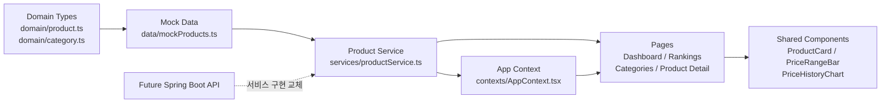

# PricePulse


PricePulse는 GPU, CPU, 노트북의 가격 흐름을 비교해 구매자와 판매자가 현재 가격 수준과 적정 거래 구간을 판단하도록 돕는 프런트엔드 데모입니다.

화면은 `/api/products`가 Supabase PostgreSQL에서 조회한 다나와 상품과 월별 가격
이력을 사용합니다. 별도의 서버 측 CLI가 다나와 상품 목록과 가격 이력을 수집합니다.

## 주요 기능

- GPU 10개, CPU 9개, 노트북 9개의 데모 상품 제공
- 최근 6개월 가격 변동폭 TOP 10
- 최저가 근접 상품 탐색
- 카테고리별 가격 흐름 요약
- 카테고리 필터, 정렬, 페이지 번호 방식의 전체 순위
- 가격 범위와 현재 가격 위치 시각화
- Recharts 기반 가격 이력 차트
- 구매자와 판매자 관점의 적정 거래 가격 안내
- 라이트·다크 테마와 사용자 선택 저장
- MP4 기반 전체 화면 인트로와 접근성 fallback
- 데스크톱, 태블릿, 모바일 반응형 레이아웃

## 기술 스택

| 영역             | 기술                                  |
| ---------------- | ------------------------------------- |
| UI               | React 19, TypeScript                  |
| 빌드             | Vite 7, esbuild                       |
| 스타일           | Tailwind CSS 4, CSS Custom Properties |
| 라우팅           | wouter                                |
| 차트             | Recharts                              |
| UI 기반 컴포넌트 | Radix UI                              |
| 아이콘           | Lucide React                          |
| 서버             | Express 정적 배포 서버                |
| 패키지 관리자    | pnpm                                  |

## Architecture

PricePulse는 화면 컴포넌트가 목업 파일을 직접 읽지 않도록 도메인, 데이터, 서비스, UI 계층을 분리합니다.



### 계층별 책임

#### Domain

- `ProductCategory`: 현재 노출하는 `GPU`, `CPU`, `LAPTOP` 식별자
- `Product`: 상품 기본 정보, 가격 요약, 적정 가격 범위, 가격 이력
- `PriceHistoryPoint`: 날짜별 가격
- `PriceStatus`: 최저가 근접부터 최고가 근접까지의 텍스트 상태
- `PriceSummary`, `FairPriceRange`: 향후 API DTO 분리에 사용할 가격 정보

가격 변동폭, 현재 위치, 최저가 차이, 평균 가격과 가격 상태는 목업 seed에 중복 저장하지 않고 데이터 생성 과정에서 계산합니다.

#### Data

`client/src/data/mockProducts.ts`가 28개 데모 상품과 서로 다른 가격 이력을 생성합니다.

상품 가격은 특정 판매처의 실제 가격을 의미하지 않으며, 실제 거래 가격이나 가격 예측을 보장하지 않습니다.

#### Service

`client/src/services/productService.ts`가 UI에서 사용하는 데이터 접근 경계를 제공합니다.

- `getProducts()`
- `getProductsByCategory(category)`
- `getTopPriceRangeProducts(limit)`
- `getNearLowestPriceProducts(limit)`
- `getProductById(id)`
- `getRelatedProducts(product, limit)`
- `getCategorySummary(category)`
- `sortProducts(products, sort)`

향후 Spring Boot API를 연결할 때 이 서비스의 구현을 HTTP 기반 비동기 함수로 교체하고, 페이지와 공용 컴포넌트는 기존 `Product` 도메인을 계속 사용합니다.

#### Application State

`AppContext`는 상품 데이터와 인트로 표시 상태를 제공합니다.

- 인트로 완료 여부: `sessionStorage`
- 저장 키: `pricepulse-intro-seen`
- 강제 재생: `?showIntro=true`
- 인트로 활성 중 메인 UI는 `inert` 및 `aria-hidden` 처리

테마는 별도 `ThemeContext`에서 관리하며 `html[data-theme]`, CSS 변수, `localStorage`의 `pricepulse-theme` 값을 동기화합니다.

#### UI

페이지는 데이터 선택과 화면 구성을 담당하고, 상품 표현은 공용 컴포넌트로 분리합니다.

- `ProductCard`: 상품 요약, 가격 상태, 가격 범위, 상세 링크
- `PriceRangeBar`: 최저가·적정 범위·최고가와 현재 위치
- `PriceHistoryChart`: 스카이 블루 가격선과 주황색 현재 가격점
- `AmbientPriceSignalCanvas`: 메인 Hero의 자동 이동·포인터 반응형 배경
- `IntroVideo`: 영상 재생, HTML 메시지, skip, fallback과 cleanup

## 프로젝트 구조

```text
client/
├── public/
│   ├── images/categories/       # 내부 카테고리 대표 SVG
│   └── videos/                  # 인트로 MP4
└── src/
    ├── components/
    │   ├── intro/               # 영상 인트로와 레이어
    │   └── ui/                  # Radix 기반 UI primitives
    ├── contexts/                # 앱 상태와 테마
    ├── data/                    # 데모 목업 데이터
    ├── domain/                  # Product와 Category 타입
    ├── lib/                     # 포맷팅, 페이지네이션, Canvas 엔진
    ├── pages/                   # 라우트 단위 화면
    ├── services/                # 상품 데이터 접근 계층
    ├── App.tsx                  # Provider와 라우팅
    └── index.css                # 테마 토큰과 전역 스타일
server/
├── integrations/danawa/         # 다나와 목록·가격 이력 client와 parser
├── repositories/                # PostgreSQL 상품·가격 저장소
├── services/                    # 단일·대량 Backfill 흐름
├── scripts/                     # 서버 측 CLI 진입점
└── index.ts                     # 프로덕션 정적 파일 서버
database/                        # 재현 가능한 PostgreSQL 스키마 SQL
```

## 라우팅

| 경로                       | 화면                                                        |
| -------------------------- | ----------------------------------------------------------- |
| `/`                        | Hero, 카테고리 바로가기, TOP 10, 최저가 근접, 카테고리 요약 |
| `/rankings`                | 전체 상품 순위, 카테고리 필터, 정렬, 페이지네이션           |
| `/categories?category=GPU` | 선택 카테고리의 요약과 상품 목록                            |
| `/products/:id`            | 가격 범위, 가격 이력, 구매자·판매자 관점, 관련 상품         |
| `/safe-trade`              | 적정 거래 가격 판단 방식 안내                               |

전체 순위 query 예시:

```text
/rankings?category=GPU&sort=range&page=1
```

지원 정렬:

- `range`: 가격 변동폭 큰 순
- `price-asc`: 현재 가격 낮은 순
- `price-desc`: 현재 가격 높은 순
- `near-low`: 최저가 근접 순

## 로컬 실행

Node.js와 pnpm이 필요합니다.

```bash
pnpm install --frozen-lockfile
pnpm run dev
```

실제 DB 상품을 조회하려면 `.env.example`을 참고해 `.env.local`을 설정하고 별도
터미널에서 `pnpm run dev:api`를 실행합니다. Vite의 `/api` 요청은 로컬 API 서버
`http://127.0.0.1:3001`로 전달됩니다. DB 연결 실패 시 화면은 오류와 재시도를
제공하며 목업 가격으로 대체하지 않습니다.

## 상품 조회 API

`GET /api/products`는 다나와 원본 URL과 유효 월별 이력을 가진 상품을 반환합니다.
Vercel에서는 `api/products.ts` 서버 함수, Express에서는 같은 handler를 사용합니다.
DB 비밀번호는 서버의 `DB_URL`, `DB_USERNAME`, `DB_PASSWORD` 환경변수로만 전달하며
`VITE_` 환경변수에 넣지 않습니다. Vercel Production에도 해당 변수를 설정해야 합니다.

한국시간 조회 날짜의 직전 달까지 6개월 구간으로 최저·최고·월별 최저가의 평균과 기존
가격 범위를 계산합니다. 없는 월은 생성하지 않습니다. `priceHistory.date`는 실제 관측
일자가 아닌 `YYYY-MM`이며 진행 중인 이번 달은 포함하지 않습니다.
`currentPrice`는 API 요청마다 다나와 상품목록에서 확인한 현재 최저가입니다. DB에
쓰지 않으며 완료된 조회 결과를 캐시하지 않습니다. 동시에 들어온 요청만 진행 중인
외부 조회를 공유합니다. 현재가를 찾지 못하면 `null`과 `UNKNOWN` 상태를 반환합니다.
과거 가격으로 현재가를 대체하지 않습니다. `currentPriceCheckedAt`은 조회 시각,
`currentPriceMonth`는 한국시간 현재 월입니다. 차트는 이 현재가를 별도의 이번 달
점으로 표시합니다. 다나와 목록은 페이지당 100개, 요청 간격 1초로 순차 조회하므로
가격을 불러오는 데 수 초에서 수십 초가 걸릴 수 있습니다.
적정 범위는 기존 참고용 계산 규칙이며 실시간 가격·예측을 제공하지 않습니다.

상품목록 탐색 없이 수동으로 등록한 테스트 매핑은 원본 URL이 없으므로 공개 목록에서
제외합니다. CPU·노트북은 해당 카테고리의 DB 상품이 없으면 빈 목록으로 표시됩니다.
응답은 `Cache-Control: no-store`이며 DB 장애 시 `503 CATALOG_UNAVAILABLE`을 반환합니다.

### 주간 가격 갱신

`.github/workflows/refresh-danawa.yml`은 매주 월요일 06:17(한국시간)에 실행됩니다.
GitHub 예약 실행은 지연될 수 있습니다. 수동 실행도 지원합니다. GitHub repository
Secrets에 `DB_URL`, `DB_USERNAME`, `DB_PASSWORD`가 필요합니다. 기존 매핑 상품을
순차 처리하며 `24 → 12 → 6` 구간의 **지난달까지 월별 최저가**만 upsert합니다.
진행 중인 현재 월은 저장하지 않습니다. 기존 Backfill의 10,000건 종료 조건을 사용하지
않으므로 목표 달성 후에도 등록된 모든 상품을 갱신합니다. 신규 상품 탐색은 기존
Backfill CLI에서 별도로 실행합니다.

로컬 실행: `node --env-file=.env.local --import tsx server/scripts/refreshDanawa.ts`.
개별 상품 실패는 격리하며 DB 장애는 전체 실행을 중단합니다. 다나와가 가격을
제공하지 않는 상품·월을 임의로 채우지 않습니다.

Vite 개발 서버가 출력한 로컬 주소로 접속합니다.

인트로를 다시 확인하려면 다음 query를 사용합니다.

```text
http://localhost:3000/?showIntro=true
```

## 검증과 빌드

```bash
# TypeScript 검사
pnpm run check

# 프런트엔드와 Express 서버 프로덕션 빌드
pnpm run build

# 빌드 결과 실행
pnpm run start

# Vite 프리뷰
pnpm run preview

# 단위 테스트
pnpm run test
```

## Supabase 가격 이력 Backfill

서버는 Supabase를 일반 PostgreSQL datasource로 사용합니다. `.env.example`을 참고해
`DB_URL`, `DB_USERNAME`, `DB_PASSWORD`를 실행 환경에 설정하고 실제 값은 커밋하지 않습니다.
Supabase Dashboard의 **SQL Editor**에서 다음 파일을 순서대로 실행합니다.

1. `database/001_initial_price_history.sql`: 상품, 외부 상품 매핑, 월별 가격 이력과 unique 제약
2. `database/002_product_discovery_fields.sql`: 탐색 시점 최저가, 등록월, 원본 상품 URL

PricePulse 상품과 다나와 상품 코드는 다음과 같이 연결합니다. 상품 ID는 현재 프런트
도메인과 동일한 문자열을 사용합니다.

```sql
INSERT INTO products (id, name, category)
VALUES ('gpu-rtx-5080', 'GeForce RTX 5080 그래픽카드', 'GPU')
ON CONFLICT (id) DO NOTHING;

INSERT INTO product_source_mappings (product_id, source, external_product_id)
VALUES ('gpu-rtx-5080', 'DANAWA', '9503733')
ON CONFLICT (product_id, source)
DO UPDATE SET external_product_id = EXCLUDED.external_product_id, updated_at = now();
```

스키마와 매핑을 준비한 뒤 공개 API 없이 내부 CLI로 한 상품을 수집할 수 있습니다.

```bash
pnpm run build
pnpm run backfill:danawa -- gpu-rtx-5080
```

GPU 상품을 대량 탐색하고 유효 이력 10,000건을 목표로 Backfill하려면 다음 명령을
사용합니다. 브라우저에 DB 관리자 권한을 노출하지 않고 서버 측 Node 실행 환경에서만
동작합니다.

```bash
pnpm run build
pnpm run backfill:danawa:bulk
```

수집기는 월별 데이터인 `"24".result`를 우선하고 유효 데이터가 없으면 `"12"`, `"6"`
순으로 하나의 구간만 선택합니다. 동일 월·동일 가격은 건너뛰고 가격이 달라졌으면 기존
행을 갱신합니다. 상품별 가격 저장은 트랜잭션으로 처리하며 DB unique 제약도 중복을
차단합니다. 개별 상품의 HTTP·파싱 실패는 기록하고 다음 상품을 계속 처리합니다.

다음 환경변수로 외부 요청과 실행 규모를 조절할 수 있습니다. 기본값은 외부 서비스에
부담을 주지 않도록 요청 간격 1초, 동시성 1, 재시도 2회입니다.

| 환경변수                    |  기본값 | 설명                              |
| --------------------------- | ------: | --------------------------------- |
| `DANAWA_REQUEST_DELAY_MS`   |  `1000` | 전체 다나와 요청 사이 최소 간격   |
| `DANAWA_MAX_CONCURRENCY`    |     `1` | 상품 처리 동시성, 최대 5          |
| `DANAWA_RETRY_COUNT`        |     `2` | 429·5xx·네트워크 오류 재시도 횟수 |
| `DANAWA_RETRY_BACKOFF_MS`   |  `2000` | 재시도 기본 backoff               |
| `DANAWA_REQUEST_TIMEOUT_MS` | `10000` | 요청 timeout                      |
| `DANAWA_BATCH_SIZE`         |    `30` | 페이지 내 처리 batch 크기         |
| `DANAWA_LIST_COUNT`         |    `30` | 목록 페이지당 상품 수             |
| `DANAWA_TARGET_PRICE_COUNT` | `10000` | DB 유효 이력 종료 목표            |

CI에서는 타입 검사, 단위 테스트, 프로덕션 빌드를 순서대로 실행합니다.

## 배포

PricePulse는 Vercel 정적 배포를 기본 경로로 사용합니다.

- 빌드 명령: `pnpm run build`
- 정적 출력: `dist/public`
- CI: `.github/workflows/ci.yml`
- Production: `.github/workflows/deploy-production.yml`
- 운영 절차: `docs/deployment.md`
- Rollback: `docs/rollback.md`

Production 배포는 GitHub `production` Environment의 수동 승인 후 실행합니다.

## 가격 계산 기준

```ts
priceRangeAmount = sixMonthHighPrice - sixMonthLowPrice;

priceRangeRate =
  sixMonthLowPrice > 0 ? (priceRangeAmount / sixMonthLowPrice) * 100 : 0;

currentPositionRate =
  priceRangeAmount > 0
    ? ((currentPrice - sixMonthLowPrice) / priceRangeAmount) * 100
    : 50;

lowestPriceDifferenceRate =
  sixMonthLowPrice > 0
    ? ((currentPrice - sixMonthLowPrice) / sixMonthLowPrice) * 100
    : 0;
```

최저가 근접 상품은 다음 조건으로 선택합니다.

```ts
currentPrice <= sixMonthLowPrice * 1.1;
```

가격 범위 마커는 UI에서 0~100% 사이로 제한합니다.

## 정적 리소스와 성능

- 상품 이미지는 외부 URL 대신 내부 SVG를 사용합니다.
- 인트로 영상은 JavaScript에 import하지 않고 `/videos/pricepulse-intro.mp4` 정적 경로로 제공합니다.
- 인트로 종료 후 video를 정지하고 컴포넌트를 unmount합니다.
- 모바일과 `prefers-reduced-motion`에서는 인트로 fallback과 효과 축소 정책을 적용합니다.
- 메인 Canvas는 인트로 중 실행하지 않고, 메인 화면 활성 후 하나의 animation loop만 사용합니다.

## 현재 범위에서 제외된 기능

- 실제 상품 검색
- 로그인과 사용자 계정
- 관심 상품과 가격 알림
- 실제 결제, 에스크로, 판매 등록
- 외부 가격 API
- 크롤링과 배치 수집
- 사용자 가격 입력 체험

## 향후 확장

- Spring Boot 상품·가격 이력 API 연결
- 메모리, 메인보드, SSD, 모니터 카테고리 추가
- 승인된 모델별 상품 이미지 관리
- API 응답 캐시와 로딩·오류 상태
- 자동화 테스트와 접근성 회귀 테스트
- Recharts와 메인 번들의 추가 코드 분할
